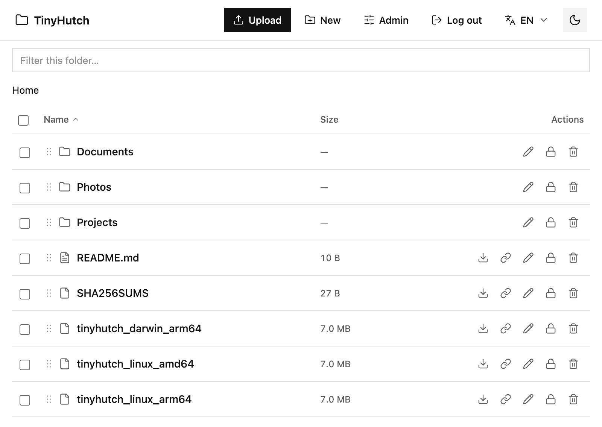

# TinyHutch

**English** | [中文](README.zh.md)

[](https://github.com/bosswnx/tinyhutch/releases/latest)
[](LICENSE)
[](https://go.dev/)

TinyHutch is a **simple, single-binary, self-hosted file manager**. Point it at a directory and manage those files from any browser — upload, rename, move, download, and share — with password locks for individual files and directories. No database, no runtime, no dependencies.



## Why TinyHutch

- **One binary, zero dependencies.** A ~7 MB Go executable for Linux and macOS (amd64/arm64). No Node, PHP, Python, or database to install.
- **Simple by design.** Run `./tinyhutch /srv/files` and you are done; `config.json` is created on first start.
- **Per-path password locks.** Lock a file or a whole directory subtree with its own password. Unlocking one path does not unlock the rest.
- **Built for sharing.** Copy a download link for any file, or zip and download a whole folder. Links work in scripts and with `curl`.
- **Comfortable UI.** Mobile layout, dark mode, and English/Chinese support.

## Quick start

Download the binary for your platform from [Releases](https://github.com/bosswnx/tinyhutch/releases/latest), then:

```bash
chmod +x tinyhutch_linux_amd64
./tinyhutch_linux_amd64 /path/to/files
```

TinyHutch serves the current directory by default and listens on `127.0.0.1:7500`, creating `config.json` in the served directory.

```bash
./tinyhutch                      # serve the current directory
./tinyhutch /srv/files           # serve a specific directory
./tinyhutch --config my.json     # use a specific config file
```

Open <http://127.0.0.1:7500>.

> Running on a remote server? Set `listen_host` to `0.0.0.0` and put TinyHutch behind a TLS reverse proxy. Keep `admin_password` set and `insecure_cookie` off in production.

## Docker

The repository ships a `Dockerfile` and `docker-compose.yml`, so deployment is one command:

```bash
docker compose up -d --build
docker compose logs tinyhutch   # the first start prints the generated admin password
```

(`make docker-up` is a shortcut for the same command.)

Open <http://localhost:7500>. Files are served from `./data`; `./data/config.json` is created on first start and `./data/.tinyhutch.secret` holds the session key.

To set the admin password, host port, upload limit, or path locks before the first start, copy `.env.example` to `.env` and edit it:

```bash
cp .env.example .env
docker compose up -d --build
```

Environment variables are only used while `config.json` is being created. Afterwards edit `./data/config.json` directly (TinyHutch reloads it automatically; `listen_host`/`listen_port` changes need a restart). The admin password can also be changed in the web UI under `/admin`.

Behind an HTTPS reverse proxy, set `TINYHUTCH_TRUST_PROXY=true` and `TINYHUT_INSECURE_COOKIE=false` (optionally `TINYHUT_BIND=127.0.0.1` so only the proxy can reach the port). Raise the proxy's request-body limit to match `max_upload_mb` (for nginx: `client_max_body_size 4096m;`).

Useful commands:

```bash
docker compose logs -f tinyhutch
docker compose restart
docker compose down
```

The container drops to uid/gid `1000` after startup. If `./data` is not writable by that user (common with bind mounts on Linux), run `sudo chown -R 1000:1000 ./data` or set `user:` in the compose file.

## Configuration

`config.json` is read from the served directory (or from `--config`). Every field must be present, or TinyHutch will not start. The template is [`config.example.json`](config.example.json).

| Field | Description |
|---|---|
| `site_name` | Browser title and top-bar name |
| `listen_host` | Listen address |
| `listen_port` | Listen port |
| `admin_password` | Admin password; when empty, clicking login signs in directly |
| `session_hours` | Session lifetime (hours) |
| `max_upload_mb` | Per-file upload limit (MB) |
| `show_hidden` | Show hidden files |
| `log_level` | Log level |
| `trust_proxy` | Trust `X-Forwarded-For`; enable only behind a trusted reverse proxy |
| `insecure_cookie` | Use a non-Secure cookie for local HTTP testing; keep `false` in production |
| `rules` | Access rule list |

TinyHutch watches `config.json` and reloads changes automatically; `listen_host` and `listen_port` changes require a restart.

### Locking paths

Add rules to require a password for specific paths:

```json
"rules": [
  { "path": "/private", "password": "secret" },
  { "path": "/reports/q4.pdf", "password": "another-secret" }
]
```

A locked directory also locks everything below it, and rule paths cannot overlap. Unlocking a path only unlocks that path and its children for the current session.

## Build

Requires Go ≥ 1.25.

```bash
make build    # local binary at dist/tinyhutch
make test     # unit + integration tests
make dist     # linux/amd64, linux/arm64, darwin/amd64, darwin/arm64
make snapshot # local GoReleaser dry run into .goreleaser/
```

## License

[MIT](LICENSE)
